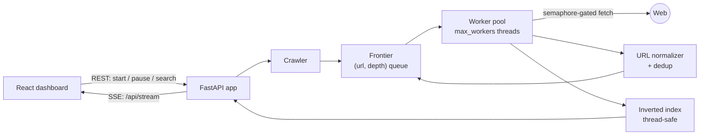

# Spidey

**A parallel, depth-limited web crawler with a thread-safe inverted index and a live operations dashboard.**


Spidey crawls a site with a bounded pool of worker threads, indexes every page as it arrives, and streams its internal state (workers, frontier, visited set, top terms) to a React dashboard over Server-Sent Events. You can pause, resume, stop, or add seeds while a crawl is running, and search the index at any point.

## Features

- **Bounded concurrency.** A thread pool sized by `max_workers`, with HTTP fetches gated by a semaphore (`max_concurrent_fetches`) so the crawler never exceeds its request budget.
- **Thread-safe frontier.** A shared queue of `(url, depth)` pairs with depth, page-count, and same-host limits enforced at enqueue time.
- **URL canonicalization and deduplication.** Scheme and host are lowercased, fragments and default ports dropped, paths resolved, and query parameters sorted before the visited-set check.
- **Live inverted index.** Term → postings (`url`, term frequency, snippet), updated under a lock while workers write concurrently.
- **Search.** Term-frequency ranking with result snippets, available during and after a crawl.
- **Runtime control.** Start, pause, resume, stop, and add seeds through the API or the dashboard.
- **Real-time telemetry.** Server-Sent Events push crawl progress to the UI without polling.

## Architecture



## Getting started

**Prerequisites:** Python 3.10+, Node.js 18+.

```bash
git clone https://github.com/zaidbinnaveed/Spidey.git
cd Spidey

# Backend
python -m pip install -r backend/requirements.txt

# Frontend
npm ci
```

Run both together:

```bash
npm run spidey      # backend on :8001, dashboard on :5173
```

Or separately:

```bash
python -m uvicorn backend.app:app --host 127.0.0.1 --port 8001
npm run dev
```

Open http://localhost:5173. The Vite dev server proxies `/api` to the backend.

## API

| Method | Endpoint | Purpose |
| --- | --- | --- |
| `GET` | `/api/health` | Liveness check |
| `GET` | `/api/config` | Active crawler configuration |
| `POST` | `/api/start` | Start a crawl from one or more seeds |
| `POST` | `/api/pause` · `/api/resume` · `/api/stop` | Lifecycle control |
| `POST` | `/api/add-seed` | Add a seed to a running crawl |
| `GET` | `/api/stats` | Snapshot of workers, frontier, and counts |
| `GET` | `/api/pages` | Paginated list of indexed pages |
| `GET` | `/api/top-keywords?k=25` | Highest-weight terms in the index |
| `GET` | `/api/search?q=...&k=20` | Ranked search results with snippets |
| `GET` | `/api/stream` | Server-Sent Events feed |

## Configuration

All limits live in [`config.json`](config.json):

| Key | Default | Meaning |
| --- | --- | --- |
| `crawler.max_workers` | 12 | Worker threads |
| `crawler.max_concurrent_fetches` | 12 | Simultaneous HTTP requests |
| `crawler.max_depth` | 2 | Link hops from the seed |
| `crawler.max_pages` | 500 | Hard cap on pages fetched |
| `crawler.request_timeout_sec` | 12 | Per-request timeout |
| `crawler.same_host_only` | true | Stay on the seed's host |
| `index.min_token_len` | 2 | Shortest indexed token |

## Project structure

```text
backend/
├── app.py              FastAPI routes and SSE stream
└── spidey/
    ├── crawler.py      worker pool, frontier, crawl lifecycle
    ├── text_index.py   thread-safe inverted index and ranking
    ├── url_utils.py    normalization and link extraction
    ├── config.py       typed, validated configuration
    └── models.py
src/                    React + TypeScript dashboard
docs/proposal.tex       original project proposal
config.json             crawler defaults and safety limits
```

## Testing

```bash
npm test
```

## Limitations and roadmap

- Ranking is raw term frequency; TF-IDF or BM25 would improve relevance.
- `respect_robots_txt` exists in the config but is **not yet enforced**. Adding a cached `robots.txt` check per host is the next planned change.
- The index is in memory and is lost when the server stops.

## Responsible use

Only crawl sites you are authorized to crawl, and respect their terms, rate limits, and server capacity. The default limits are safety rails, not permission.

## License

[MIT](LICENSE) © Zaid Bin Naveed
